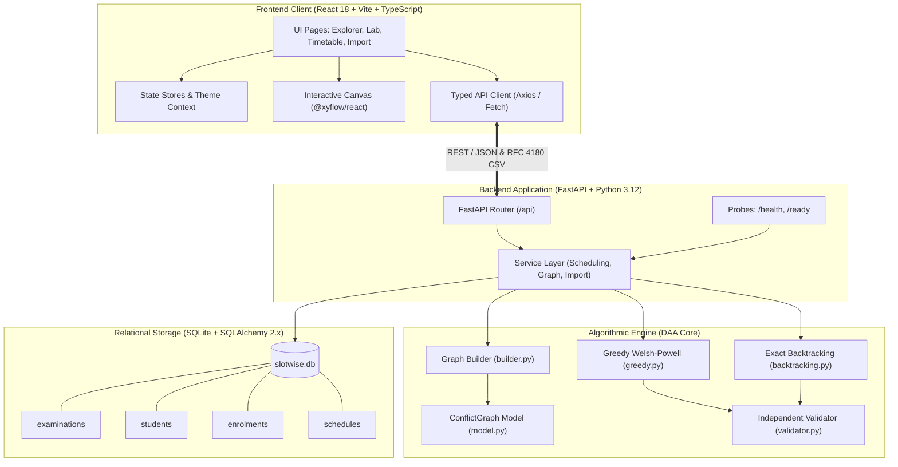
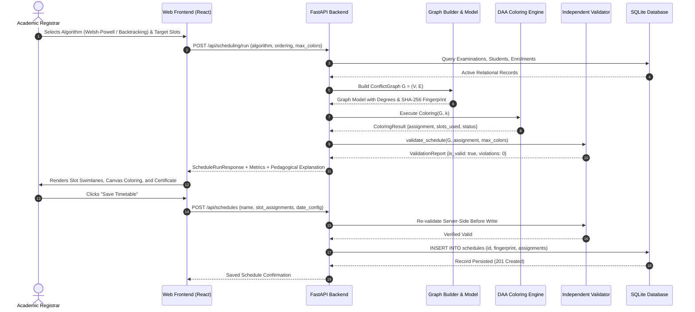
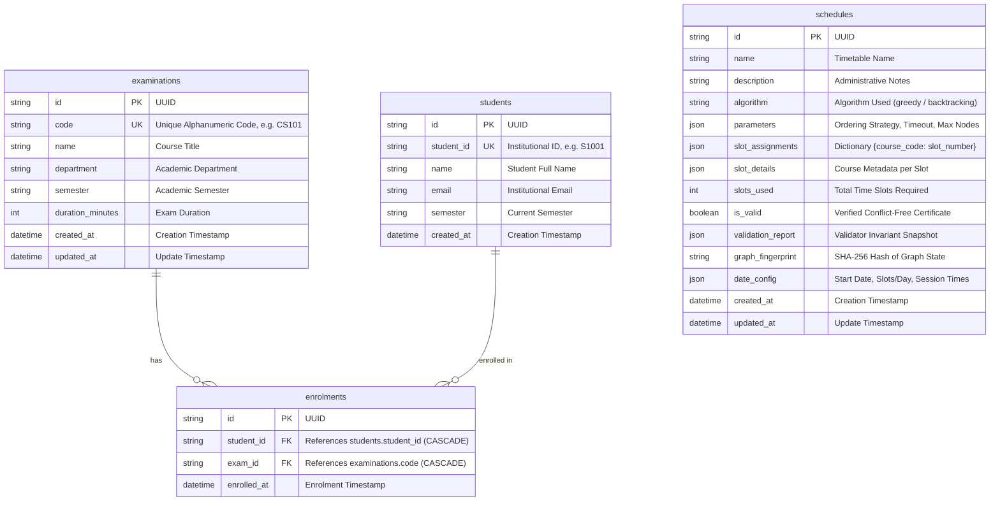

# SLOTWISE: Exam Scheduling Studio

[](#17-testing--verification)
[](#17-testing--verification)
[](#9-technology-stack)
[](#9-technology-stack)
[](#9-technology-stack)
[](#9-technology-stack)
[](#11-installation--execution-guide)

> **"Every exam has its place. Every conflict has a solution."**

**SLOTWISE** is a university examination timetable conflict resolver built upon graph-theoretic models and Design and Analysis of Algorithms (DAA) principles. It models examinations as vertices in an undirected conflict graph, student co-enrolments as conflict edges, and generates provably conflict-free examination schedules using both polynomial-time heuristics (Welsh-Powell Greedy Graph Coloring) and exponential exact state-space search (Backtracking with forward checking and pruning).

Every generated timetable is independently verified by a standalone validation engine and persisted with deterministic SHA-256 graph fingerprinting for automated stale-schedule invalidation.

---

## Table of Contents

1. [Product Overview & Objective](#1-product-overview--objective)
2. [Problem Statement & Mathematical Formulation](#2-problem-statement--mathematical-formulation)
3. [DAA Concepts & Algorithmic Principles](#3-daa-concepts--algorithmic-principles)
4. [Conflict Graph Representation](#4-conflict-graph-representation)
5. [Greedy Graph Coloring (Welsh-Powell Heuristic)](#5-greedy-graph-coloring-welsh-powell-heuristic)
6. [Exact Backtracking Search & Pruning](#6-exact-backtracking-search--pruning)
7. [Complexity Analysis Matrix](#7-complexity-analysis-matrix)
8. [System Architecture & Component Flow](#8-system-architecture--component-flow)
9. [Technology Stack](#9-technology-stack)
10. [Annotated Project Structure](#10-annotated-project-structure)
11. [Installation & Execution Guide](#11-installation--execution-guide)
12. [API Endpoint Reference](#12-api-endpoint-reference)
13. [Database Design & Relational Schema](#13-database-design--relational-schema)
14. [CSV Import Formats & Validation Rules](#14-csv-import-formats--validation-rules)
15. [How to Generate a Conflict-Free Timetable](#15-how-to-generate-a-conflict-free-timetable)
16. [How to Save, Manage, and Export Timetables](#16-how-to-save-manage-and-export-timetables)
17. [Testing & Verification](#17-testing--verification)
18. [Known Limitations & Design Trade-Offs](#18-known-limitations--design-trade-offs)
19. [Demonstration Guide & Benchmark Walkthrough](#19-demonstration-guide--benchmark-walkthrough)

---

## 1. Product Overview & Objective

University academic registries face a recurring logistical bottleneck: scheduling dozens or hundreds of course examinations across a compact exam period without subjecting any student to simultaneous examinations.

Manual scheduling is error-prone, labor-intensive, and computationally fragile. **SLOTWISE: Exam Scheduling Studio** addresses this challenge through algorithmic automation:
- **Relational Data Management:** Manages examinations, students, and course enrolments with strict referential integrity.
- **Dynamic Conflict Graph Modeling:** Automatically computes symmetric pairwise conflict edges and weights based on real-time student registrations.
- **Dual Algorithmic Engine:**
  - *Greedy Coloring (Welsh-Powell):* $O(|V|^2 + |E|)$ heuristic guaranteeing $\chi(G) \le \Delta(G) + 1$ slots.
  - *Exact Backtracking Search:* $O(k^{|V|})$ state-space search with degree ordering and dead-end pruning to compute the exact chromatic number $\chi(G)$ or mathematically prove infeasibility for $k$ slots.
- **Independent Validation Certificate:** Guarantees schedule correctness via an independent invariant validator verifying completeness, range bounds, and 0 adjacent clashes.
- **Stale Schedule Invalidation:** Detects any modification to underlying student enrolments via cryptographic SHA-256 graph fingerprinting.
- **Interactive UI & Visual Studio:** Featuring interactive React Flow conflict graph exploration, algorithm comparison benchmarks, calendar date mapping, RFC 4180 CSV export, and print-ready stylesheets.

---

## 2. Problem Statement & Mathematical Formulation

### The Examination Timetabling Problem (ETP)
Given:
1. A set of examinations $E = \{e_1, e_2, \dots, e_n\}$.
2. A set of students $S = \{s_1, s_2, \dots, s_m\}$.
3. An enrolment relation $R \subseteq S \times E$, where $(s, e) \in R$ denotes that student $s$ is registered for examination $e$.

Find an assignment of examinations to time slots (colors) $\sigma: E \to \{1, 2, \dots, k\}$ such that:
$$\forall e_i, e_j \in E, \quad (\exists s \in S \text{ s.t. } (s, e_i) \in R \land (s, e_j) \in R) \implies \sigma(e_i) \ne \sigma(e_j)$$

### Reduction to Graph Vertex Coloring
We construct an undirected conflict graph $G = (V, E_G)$:
- Each examination $e \in E$ corresponds to a unique vertex $v \in V$, so $|V| = n$.
- An undirected edge $(u, v) \in E_G$ exists if and only if:
  $$\{s \in S \mid (s, u) \in R\} \cap \{s \in S \mid (s, v) \in R\} \ne \emptyset$$
- The edge weight $w(u, v)$ represents the co-enrolment count:
  $$w(u, v) = |\{s \in S \mid (s, u) \in R \land (s, v) \in R\}|$$

A conflict-free timetable using $k$ time slots is equivalent to a **proper vertex $k$-coloring** of $G$. The minimum number of time slots required is the **chromatic number** $\chi(G)$. Because determining whether $\chi(G) \le k$ is NP-complete for $k \ge 3$ (Karp, 1972), universities require both rapid heuristic approximation algorithms and exact bounded search algorithms.

---

## 3. DAA Concepts & Algorithmic Principles

SLOTWISE implements fundamental concepts from Design and Analysis of Algorithms:

| DAA Principle | Implementation in SLOTWISE |
|---|---|
| **Graph Modeling & Dual Graph Reduction** | Bipartite student-exam relations $S \times E$ are projected into an undirected conflict graph $G = (V, E)$. |
| **Greedy Heuristics & Vertex Orderings** | Implements the Welsh-Powell heuristic: sorting vertices in descending order of degree $d(v)$ before sequential coloring. |
| **Upper Bounding (Brooks' Theorem)** | For any connected graph that is neither complete nor an odd cycle, $\chi(G) \le \Delta(G)$. Welsh-Powell ensures $\chi(G) \le \Delta(G) + 1$. |
| **Lower Bounding (Clique Number $\omega(G)$)** | The chromatic number satisfies $\chi(G) \ge \omega(G)$, where $\omega(G)$ is the size of the largest complete subgraph (clique) of mutual conflicts. |
| **State-Space Tree Search & Backtracking** | Systematically traverses the decision tree of slot assignments $\sigma(v_1), \dots, \sigma(v_n)$ depth-first. |
| **Forward Checking & Dead-End Pruning** | Prunes search branches as soon as a slot assignment clashes with an already-colored adjacent neighbor. |
| **MRV / Degree Ordering in Search** | Colors highest-degree and most-constrained vertices first to induce early dead-end cutoffs at shallow tree depths. |
| **Independent Verification & Certification** | Employs an independent $O(\|V\| + \|E\|)$ validator that verifies zero adjacent conflicts, total completeness, and valid color domains without trusting algorithm internals. |

---

## 4. Conflict Graph Representation

```
   [ CS101 ] ────────────── (Weight: 2) ────────────── [ MATH101 ]
        \                                                 /
         \                                               /
      (Weight: 1)                                   (Weight: 3)
           \                                           /
            \                                         /
             ─────────────── [ PHYS101 ] ────────────
                                 
                 [ ENG101 ]  <-- Isolated Vertex (d=0)
```

The conflict graph $G = (V, E)$ maintains:
- **Vertices ($V$):** Every registered course is represented. Isolated courses ($d(v) = 0$, e.g. single-enrolment humanities courses) remain explicit vertices.
- **Edges ($E$):** Symmetric, undirected conflict edges with co-enrolled student identifiers stored in the edge metadata.
- **Adjacency Representation:** Implemented via `dict[str, set[str]]` providing $O(1)$ edge-existence queries and duplicate-free edge insertion.
- **Conflict Degree $d(v)$:** The number of courses that conflict with examination $v$.
- **Maximum Degree $\Delta(G)$:** $\max_{v \in V} d(v)$.
- **Graph Density:** $D = \frac{2|E|}{|V|(|V| - 1)}$ for $|V| > 1$, reflecting academic schedule congestion.
- **Disconnected Components:** Disconnected components and isolated vertices are processed naturally without inflating time slots.

---

## 5. Greedy Graph Coloring (Welsh-Powell Heuristic)

### Algorithm Steps
1. Compute the conflict degree $d(v)$ for every vertex $v \in V$.
2. Sort vertices in descending order of degree: $d(v_1) \ge d(v_2) \ge \dots \ge d(v_n)$. (Ties are broken deterministically by alphanumeric code).
3. Initialize all vertices as uncolored.
4. For each vertex $v_i$ in the sorted sequence:
   - Identify the set of colors already assigned to its neighbors: $C_{\text{nbr}} = \{\sigma(u) \mid u \in \text{Adj}(v_i) \land \sigma(u) \ne \text{None}\}$.
   - Assign to $v_i$ the smallest positive integer color $c \in \{1, 2, 3, \dots\}$ such that $c \notin C_{\text{nbr}}$.
5. If a maximum color limit $k$ was specified and $c > k$, record status `INCOMPLETE` with partial assignments. Otherwise, return status `SUCCESS`.

### Why Vertex Ordering Matters
Greedy coloring with an arbitrary vertex ordering can require significantly more colors than $\chi(G)$.

**Counterexample (Crown Graph $K_{3,3}$ minus a matching):**
Consider a bipartite graph $G = (A \cup B, E)$ where $A = \{a_1, a_2, a_3\}$ and $B = \{b_1, b_2, b_3\}$, with edges $(a_i, b_j)$ for all $i \ne j$.
- The chromatic number is $\chi(G) = 2$ (since it is bipartite).
- If colored in adversarial order $a_1, b_1, a_2, b_2, a_3, b_3$:
  - $a_1$ gets Color 1.
  - $b_1$ is not connected to $a_1$, so $b_1$ gets Color 1.
  - $a_2$ is connected to $b_1$, so $a_2$ gets Color 2.
  - $b_2$ is connected to $a_1$, so $b_2$ gets Color 2.
  - $a_3$ is connected to $b_1, b_2$, so $a_3$ gets Color 3.
  - $b_3$ is connected to $a_1, a_2$, so $b_3$ gets Color 3.
  - The naive greedy algorithm uses **3 colors**, whereas Welsh-Powell ordering ($d(v) = 2$ for all, preserving bipartite balance) uses **2 colors**.

### Theoretical Upper Bound
$$\chi(G) \le \Delta(G) + 1$$
Welsh-Powell guarantees that no vertex ever receives a color exceeding $\Delta(G) + 1$, because when coloring any vertex $v$, it has at most $d(v) \le \Delta(G)$ colored neighbors, leaving at least one color in $\{1, 2, \dots, \Delta(G) + 1\}$ unassigned.

---

## 6. Exact Backtracking Search & Pruning

### Algorithm Steps
1. Sort vertices using Welsh-Powell descending degree order to ensure highest-degree variables are assigned first (fail-first principle).
2. Recursively explore assignments:
   $$\text{Solve}(index, assignment)$$
   - **Base Case:** If $index == |V|$, a proper $k$-coloring has been found. Return `SUCCESS`.
   - **Recursive Step:** For vertex $u = V[index]$, iterate candidate colors $c \in \{1, 2, \dots, k\}$:
     - Check safety: Verify that no neighbor $v \in \text{Adj}(u)$ already has color $c$.
     - If safe:
       - Assign $\sigma(u) = c$.
       - Recurse: $\text{Solve}(index + 1, assignment)$.
       - If recursion returns `SUCCESS`, terminate and bubble up.
       - If recursion fails, backtrack: unassign $\sigma(u) = \text{None}$.
3. If all candidate colors $1 \dots k$ for vertex $u$ lead to dead ends, backtrack to the previous decision.

### Mathematical Infeasibility vs. Resource Limits
- **Exhaustive Infeasibility (`INFEASIBLE`):** If the recursive search systematically exhausts the entire state-space tree without finding a valid assignment within time/node budgets, it mathematically proves that:
  $$\chi(G) > k$$
  *No valid timetable exists using $\le k$ time slots.*
- **Resource Limitation (`RESOURCE_LIMITED`):** If the search exceeds `max_nodes` (default: 100,000) or `timeout_seconds` (default: 5.0s), the algorithm terminates safely with status `RESOURCE_LIMITED`.
  > **Crucial Distinction:** SLOTWISE *never* reports a truncated search as proven infeasible. It explicitly informs the user that the search was bounded and recommends relaxing $k$ or adjusting node budgets.

---

## 7. Complexity Analysis Matrix

| Operation / Algorithm | Best-Case Time | Average-Case Time | Worst-Case Time | Auxiliary Space | Peak Space |
|---|---|---|---|---|---|
| **Conflict Graph Construction** | $O(\|V\| + \|R\|)$ | $O(\|V\| + \|R\| + \|E\|)$ | $O(\|V\| + \|S\| \cdot D_{\text{max}}^2)$ | $O(\|V\| + \|E\|)$ | $O(\|V\| + \|E\|)$ |
| **Welsh-Powell Greedy Coloring** | $O(\|V\| \log \|V\| + \|E\|)$ | $O(\|V\|^2 + \|E\|)$ | $O(\|V\|^2 + \|E\|)$ | $O(\|V\|)$ | $O(\|V\| + \|E\|)$ |
| **Exact Backtracking ($k$-Coloring)** | $O(\|V\|)$ *(immediate fit)* | $O(c^{\|V\|}), c < k$ *(pruned)* | $O(k^{\|V\|})$ *(dense NP-hard)* | $O(\|V\|)$ *(call stack)* | $O(\|V\| + \|E\|)$ |
| **Independent Schedule Validator** | $O(\|V\| + \|E\|)$ | $O(\|V\| + \|E\|)$ | $O(\|V\| + \|E\|)$ | $O(\|V\|)$ | $O(\|V\| + \|E\|)$ |
| **Cryptographic Graph Fingerprint (SHA-256)** | $O(\|V\| \log \|V\| + \|E\| \log \|E\|)$ | $O(\|V\| \log \|V\| + \|E\| \log \|E\|)$ | $O(\|V\| \log \|V\| + \|E\| \log \|E\|)$ | $O(\|V\| + \|E\|)$ | $O(\|V\| + \|E\|)$ |
| **CSV Validation & Parsing** | $O(N_{\text{rows}})$ | $O(N_{\text{rows}})$ | $O(N_{\text{rows}})$ | $O(N_{\text{rows}})$ | $O(N_{\text{rows}})$ |

*$|V|$ = examinations, $|E|$ = conflict edges, $|R|$ = enrolments, $|S|$ = students, $D_{\text{max}}$ = max student course load, $k$ = slots.*

---

## 8. System Architecture & Component Flow

### Component Architecture Diagram



### End-to-End Scheduling & Validation Sequence



---

## 9. Technology Stack

### Backend
- **Python 3.12:** Type hints, dataclasses, pattern matching.
- **FastAPI 0.115+:** High-performance asynchronous REST API framework with automatic OpenAPI documentation.
- **Pydantic 2.9+:** Strict data validation, response serialization, and schema generation.
- **SQLAlchemy 2.0+:** Modern ORM and transactional query builder.
- **SQLite 3:** Single-file relational database with strict `PRAGMA foreign_keys=ON`.
- **Pytest 8.0+:** Comprehensive unit, integration, and E2E test suites with isolated temporary databases.
- **Uvicorn:** High-throughput ASGI production server.

### Frontend
- **React 18:** Functional components, hooks, suspense, and concurrent mode.
- **Vite 5.4+:** High-speed development server and optimized Rollup production bundler.
- **TypeScript 5.x (Strict):** Strict null checking and end-to-end type safety.
- **Tailwind CSS 3.4+:** Utility-first design tokens with customized dark/light themes.
- **Phosphor Icons:** Accessible, cohesive iconography.
- **@xyflow/react 12+ (React Flow):** Hardware-accelerated canvas for interactive conflict graph visualization.
- **Vitest:** Blazing-fast component and unit testing with `@testing-library/react`.

---

## 10. Annotated Project Structure

```text
timetable_conflict_resolver/
├── Dockerfile                  # Multi-stage production container build
├── docker-compose.yml          # Production container orchestration with SQLite persistence
├── .dockerignore               # Container build exclusions
├── .env.example                # Root environment template
├── .gitignore                  # Git exclusions for secrets, venv, databases, caches
├── pytest.ini                  # Pytest configuration and warning filters
├── README.md                   # Complete system documentation and DAA reference
├── requirements.txt            # Root requirements pointer
│
├── backend/
│   ├── app/
│   │   ├── algorithms/
│   │   │   ├── backtracking.py # Exact Backtracking K-Coloring with pruning & diagnostics
│   │   │   └── greedy.py       # Heuristic Welsh-Powell Greedy Graph Coloring
│   │   ├── graph/
│   │   │   ├── builder.py      # Dual conflict graph builder from student enrolments
│   │   │   └── model.py        # Set-based undirected ConflictGraph data structure
│   │   ├── models/             # SQLAlchemy ORM models
│   │   │   ├── dataset.py      # Dataset metadata model
│   │   │   ├── enrolment.py    # Student-course enrolment model (composite unique key)
│   │   │   ├── examination.py  # Examination course model
│   │   │   ├── schedule.py     # Persistent timetable schedule model
│   │   │   └── student.py      # Student profile model
│   │   ├── routers/            # FastAPI API endpoint controllers
│   │   │   ├── enrolments.py   # Enrolment management routes
│   │   │   ├── examinations.py # Course catalog routes
│   │   │   ├── graph.py        # Dynamic conflict graph serialization
│   │   │   ├── health.py       # Container readiness & liveness probes (/health, /ready)
│   │   │   ├── imports.py      # CSV validation preview & sample dataset studio
│   │   │   ├── sample_data.py  # Legacy sample data routes
│   │   │   ├── schedules.py    # Timetable persistence, staleness check, CSV/JSON export
│   │   │   ├── scheduling.py   # Algorithm execution & side-by-side comparison
│   │   │   └── students.py     # Student directory routes
│   │   ├── schemas/            # Pydantic data schemas
│   │   │   ├── graph.py        # Graph vertices, edges, and metrics schemas
│   │   │   ├── health.py       # Health probe response schema
│   │   │   ├── imports.py      # CSV preview, audit reports, and commit schemas
│   │   │   ├── models.py       # Common DAA schemas (ColoringResult, ValidationReport)
│   │   │   ├── schedule.py     # Saved schedule request/response schemas
│   │   │   └── scheduling.py   # Algorithm run & comparison schemas
│   │   ├── services/           # Business logic service layer
│   │   │   ├── graph_service.py       # Dynamic graph construction & SHA-256 fingerprinting
│   │   │   ├── import_service.py      # CSV parsing, multi-encoding, and row diagnostics
│   │   │   ├── sample_data_service.py # Benchmark dataset generation & loading
│   │   │   ├── schedule_service.py    # Schedule persistence, staleness & CSV generator
│   │   │   └── scheduling_service.py  # Algorithm orchestration, timing, and explanations
│   │   ├── validation/
│   │   │   └── validator.py    # Independent schedule validation engine
│   │   ├── config.py           # Application settings and environment parsing
│   │   ├── database.py         # SQLAlchemy engine, session maker, and PRAGMA configuration
│   │   └── main.py             # FastAPI entrypoint, SPA static serving, error handlers
│   ├── tests/                  # Backend Pytest Test Suite (119 passing tests)
│   │   ├── conftest.py         # Isolated SQLite database fixtures
│   │   ├── test_api_e2e.py     # API endpoint integration tests
│   │   ├── test_api_graph.py   # Conflict graph endpoint tests
│   │   ├── test_api_imports.py # CSV validation and sample dataset studio tests
│   │   ├── test_api_schedules.py # Schedule persistence, staleness, and CSV export tests
│   │   ├── test_api_scheduling.py # Algorithm run and comparison endpoint tests
│   │   ├── test_backtracking.py # Backtracking algorithm unit tests
│   │   ├── test_database.py    # Relational integrity and cascade tests
│   │   ├── test_e2e_workflow.py # Comprehensive 15-step end-to-end user journey test
│   │   ├── test_graph.py       # Conflict graph model and builder unit tests
│   │   ├── test_greedy.py      # Welsh-Powell greedy algorithm unit tests
│   │   └── test_validator.py   # Independent schedule validator unit tests
│   ├── .env.example            # Backend environment variables example
│   └── requirements.txt        # Pinned Python package dependencies
│
└── frontend/                   # React Frontend Application
    ├── public/                 # Static assets and favicon
    ├── src/
    │   ├── components/         # Reusable UI components
    │   │   ├── calendar/       # Calendar grid and slot swimlane components
    │   │   ├── graph/          # React Flow custom nodes, toolbars, and details panel
    │   │   ├── layout/         # AppShell, Header, Sidebar navigation
    │   │   └── ui/             # Buttons, inputs, modals, cards, badges, tabs
    │   ├── context/            # AuthContext, ThemeContext, ToastContext
    │   ├── lib/                # Utility helpers (cn, formatters, slot coloring tokens)
    │   ├── routes/             # Primary application pages
    │   │   ├── AlgorithmLabPage.tsx   # Algorithm laboratory & comparative benchmarking
    │   │   ├── ConflictGraphPage.tsx  # Interactive conflict graph explorer
    │   │   ├── DashboardPage.tsx      # Overview metrics, charts, and quick actions
    │   │   ├── DataImportPage.tsx     # CSV batch importer & sample dataset studio
    │   │   ├── LandingPage.tsx        # Public marketing landing page
    │   │   ├── LoginPage.tsx          # Login experience with dev bypass
    │   │   ├── SignupPage.tsx         # Signup registration experience
    │   │   └── TimetablePage.tsx      # Timetable calendar, history, and CSV/print export
    │   ├── services/
    │   │   └── apiClient.ts    # Typed API client interfacing with FastAPI backend
    │   ├── styles/             # Design tokens and Tailwind styles
    │   └── test/               # Vitest Frontend Test Suite (73 passing tests)
    ├── index.html              # HTML shell with anti-flash theme script
    ├── package.json            # Node.js dependencies and scripts
    ├── tailwind.config.js      # Brand color tokens (#111318, #1B1E25, #F5A64A, #69C9B1)
    ├── tsconfig.json           # Strict TypeScript compiler options
    └── vite.config.ts          # Vite configuration with proxy and path aliases
```

---

## 11. Installation & Execution Guide

### Prerequisites
- **Python 3.12+**
- **Node.js 20+** and **npm 10+**
- *Optional:* **Docker** and **Docker Compose**

---

### Option A: Local Development Setup (Recommended for Development)

#### 1. Backend Setup
```bash
# Navigate to project root
cd timetable_conflict_resolver

# Create and activate virtual environment
python3 -m venv .venv
source .venv/bin/activate  # On Windows: .venv\Scripts\activate

# Install Python dependencies
pip install -r backend/requirements.txt

# Create local environment configuration
cp backend/.env.example backend/.env

# Run backend development server
python3 -m uvicorn backend.app.main:app --host 127.0.0.1 --port 8000 --reload
```
*Backend API and Swagger UI will be available at:* `http://127.0.0.1:8000/docs`

#### 2. Frontend Setup (In a New Terminal)
```bash
# Navigate to frontend directory
cd timetable_conflict_resolver/frontend

# Install Node dependencies
npm install

# Create frontend environment configuration
cp .env.example .env

# Start Vite development server
npm run dev
```
*Frontend application will be accessible at:* `http://localhost:5173`

---

### Option B: Docker Compose Setup (Single-Command Production Deployment)

Run both the compiled frontend and backend in a unified, isolated container with persistent SQLite volume storage:

```bash
# Build and run container
docker compose up --build

# Or run in detached background mode
docker compose up -d --build
```
*Open your browser at:* `http://localhost:8000`
- The React Single Page Application is served directly at `/`.
- Interactive Swagger documentation is accessible at `/docs`.
- SQLite database is persisted inside the `slotwise-data` Docker volume at `/app/data/slotwise.db`.

To stop the container:
```bash
docker compose down
```

---

## 12. API Endpoint Reference

| HTTP Method | Route Path | Description | Request Body | Response Schema / Status |
|---|---|---|---|---|
| `GET` | `/health` / `/api/health` | Service health & SQLite connection probe | None | `HealthResponse` (200) |
| `GET` | `/ready` / `/api/ready` | Container orchestrator readiness probe | None | `HealthResponse` (200 / 503) |
| `GET` | `/docs` | Interactive Swagger OpenAPI UI | None | HTML (200) |
| `GET` | `/api/exams` | List courses (paginated, search filter) | None | `ExamListResponse` (200) |
| `POST` | `/api/exams` | Register a new examination course | `ExamCreateRequest` | `ExamResponse` (201) |
| `GET` | `/api/exams/{id_or_code}` | Get course details and registered enrolments | None | `ExamResponse` (200 / 404) |
| `PATCH`| `/api/exams/{id_or_code}` | Update course metadata (name, duration, sem) | `ExamUpdateRequest` | `ExamResponse` (200) |
| `DELETE`| `/api/exams/{id_or_code}`| Delete course and cascade-remove enrolments | None | `{detail: str}` (200) |
| `GET` | `/api/students` | List students (paginated, search filter) | None | `StudentListResponse` (200) |
| `POST` | `/api/students` | Create student profile | `StudentCreateRequest` | `StudentResponse` (201) |
| `GET` | `/api/students/{id}` | Get student profile and registered courses | None | `StudentResponse` (200) |
| `PATCH`| `/api/students/{id}` | Update student name, email, or semester | `StudentUpdateRequest` | `StudentResponse` (200) |
| `DELETE`| `/api/students/{id}` | Delete student and cascade-remove enrolments | None | `{detail: str}` (200) |
| `GET` | `/api/enrolments` | List student course enrolments | None | `List[EnrolmentResponse]` (200) |
| `POST` | `/api/enrolments` | Enrol student in examination (creates conflicts) | `EnrolmentCreateRequest` | `EnrolmentResponse` (201) |
| `DELETE`| `/api/enrolments/{id}`| Remove student enrolment | None | `{detail: str}` (200) |
| `GET` | `/api/graph/conflicts` | Compute and serialize conflict graph | None | `ConflictGraphResponse` (200) |
| `POST` | `/api/scheduling/run` | Execute Welsh-Powell Greedy or Backtracking | `ScheduleRunRequest` | `ScheduleRunResponse` (200) |
| `POST` | `/api/scheduling/compare` | Run side-by-side comparative benchmark | `ScheduleCompareRequest` | `ScheduleCompareResponse` (200) |
| `GET` | `/api/scheduling/runs` | List recent in-memory algorithm runs | None | `List[ScheduleRunResponse]` (200) |
| `GET` | `/api/schedules` | List all persisted timetable schedules | None | `List[ScheduleSummaryResponse]` (200) |
| `POST` | `/api/schedules` | Validate and persist verified schedule | `ScheduleCreateRequest` | `ScheduleDetailResponse` (201) |
| `GET` | `/api/schedules/{id}` | Get saved timetable and staleness status | None | `ScheduleDetailResponse` (200) |
| `PATCH`| `/api/schedules/{id}` | Update timetable title, notes, or date config | `ScheduleUpdateRequest` | `ScheduleDetailResponse` (200) |
| `DELETE`| `/api/schedules/{id}` | Delete saved schedule (leaves courses intact) | None | `{detail: str}` (200) |
| `GET` | `/api/schedules/{id}/export/csv` | Download RFC 4180 CSV export of timetable | None | `text/csv` Attachment (200) |
| `GET` | `/api/schedules/{id}/export/json` | Download complete timetable snapshot as JSON | None | `application/json` Attachment (200) |
| `GET` | `/api/imports/templates/{type}` | Download CSV template (exams/students/enrolments)| None | `text/csv` Attachment (200) |
| `POST` | `/api/imports/{type}/preview` | Pre-flight validation preview of uploaded CSV | Multipart File | `ImportPreviewResponse` (200) |
| `POST` | `/api/imports/{type}/commit` | Commit validated CSV (atomic or valid-only) | `ImportCommitRequest` | `ImportCommitResponse` (200) |
| `GET` | `/api/imports/sample-dataset/preview` | Preview 15-exam benchmark dataset specs | None | `SampleDatasetPreviewResponse` (200) |
| `POST` | `/api/imports/sample-dataset/load` | Load benchmark dataset (append or replace) | `SampleDatasetLoadRequest` | `Dict[str, Any]` (200) |

---

## 13. Database Design & Relational Schema



### Relational Constraints Enforced
1. **Unique Examination Code:** Duplicate course codes (e.g. adding two `CS101` courses) are rejected.
2. **Unique Student ID:** Duplicate institutional student IDs are rejected.
3. **Composite Unique Enrolment:** `(student_id, exam_id)` pairs are strictly unique. Re-enrolling a student in the same course is idempotent or rejected.
4. **Cascading Deletions:** Deleting an examination or student automatically purges their associated enrolment records via SQLite `ON DELETE CASCADE`.
5. **Decoupled Schedule Deletion:** Deleting a saved timetable removes only the timetable snapshot; underlying courses and student rosters remain intact.

---

## 14. CSV Import Formats & Validation Rules

### 1. Examinations CSV (`exams`)
```csv
exam_code,subject_name,department,semester,duration
CS101,Introduction to Computer Science,Computer Science,Fall 2026,180
MATH101,Single Variable Calculus,Mathematics,Fall 2026,150
```
- **Mandatory Columns:** `exam_code`, `subject_name`.
- **Optional Columns:** `department`, `semester`, `duration`.
- **Validation Rules:** `exam_code` and `subject_name` must be non-empty strings; `duration` must be a positive integer $\ge 15$ and $\le 480$. Duplicate codes within the file are flagged.

### 2. Students CSV (`students`)
```csv
student_id,student_name,email,semester
S1001,Ada Lovelace,ada@university.edu,Fall 2026
S1002,Alan Turing,alan@university.edu,Fall 2026
```
- **Mandatory Columns:** `student_id`.
- **Optional Columns:** `student_name` (or `display_name`), `email`, `semester`.
- **Validation Rules:** `student_id` must be non-empty. Duplicate student IDs in the file are flagged.

### 3. Enrolments CSV (`enrolments`)
```csv
student_id,exam_code
S1001,CS101
S1001,MATH101
S1002,CS101
```
- **Mandatory Columns:** `student_id`, `exam_code`.
- **Validation Rules:** Referential integrity is verified against the database. If a student ID or exam code does not exist in the database, the row is marked with an invalid reference error.

### Commit Strategies
- **Atomic All-or-Nothing:** Commits the batch to SQLite if and only if 100% of rows are valid. If even one fatal error is found, the transaction is completely rolled back.
- **Valid-Only:** Commits all valid records while safely skipping duplicates and invalid rows. Returns an audit summary detailing committed vs. rejected counts.

---

## 15. How to Generate a Conflict-Free Timetable

1. **Populate Dataset:**
   - Navigate to `/data-import`.
   - Click the **Sample Dataset Studio** tab.
   - Click **"Load Benchmark Dataset"** (Select **Replace Mode** for a fresh 15-course benchmark).
2. **Inspect Conflict Topology:**
   - Navigate to `/explorer`.
   - Explore the interactive React Flow canvas.
   - Note high-conflict hubs (`MATH101`, `PHYS101`, `CS101`) and isolated components (`ENG101`).
3. **Configure & Run Algorithm:**
   - Navigate to `/laboratory`.
   - **Mode Selection:** Select **Greedy Coloring**, **Backtracking Search**, or **Run Both (Side-by-Side Benchmark)**.
   - **Vertex Ordering:** Choose **Welsh-Powell (Descending Degree)** or **Natural Order**.
   - **Slot Constraints:** Leave unconstrained to find the lowest slots, or click **"Recommend Bound"** to set $k = \Delta(G) + 1$.
   - Click **"Run Scheduling Algorithm"**.
4. **Inspect Generated Schedule & Validation Certificate:**
   - Review the metrics bar (Slots used, status, execution duration in milliseconds).
   - Read the plain-language narrative explaining algorithm decisions and bounds.
   - Check the **Validation Certificate** confirming 0 adjacent conflicts and 100% course coverage.
   - View the **Slot Allocation Swimlanes** showing courses assigned to each chromatic slot.
5. **Save Timetable:**
   - Click **"Save as Named Timetable"**.
   - Provide a title (e.g. `Fall 2026 Official Final Exam Timetable`), description notes, and optional calendar date settings.
   - Click **"Confirm & Save"**.

---

## 16. How to Save, Manage, and Export Timetables

### Calendar Date-Time Mapping
SLOTWISE maintains a strict separation of concerns between abstract chromatic slots (`Slot 1`, `Slot 2`, ...) and calendar dates:
- Users can optionally configure:
  - Examination Start Date (e.g. `2026-12-01`).
  - Slots / Sessions Per Day (1, 2, or 3).
  - Session Time Windows (e.g. `09:00 - 12:00`, `14:00 - 17:00`).
  - Weekend Exclusion (Monday–Friday scheduling).

### Stale Schedule Detection via SHA-256 Fingerprinting
Whenever a schedule is saved, SLOTWISE records a deterministic SHA-256 hash of all sorted examinations and conflict edges:
$$\text{Fingerprint} = \text{SHA-256}(\text{Sorted}(V) \cup \text{Sorted}(E))$$
If an administrator later adds courses or enrols a student creating new conflicts, the system immediately flags the saved timetable as **Stale**:
- A prominent amber warning banner informs the user that source enrolments have changed since this timetable was generated.
- The historical timetable is preserved for audit purposes, but administrators are prompted to re-run the algorithm.

### Export & Printing
- **RFC 4180 CSV Download:**
  Click **"Export CSV"** on any timetable view to download an RFC 4180 compliant CSV formatted as:
  `Slot,Date,Session Time,Exam Code,Course Name,Department,Semester,Conflict Degree,Duration (Min)`
- **Printable Timetable View (`@media print`):**
  Click **"Print"** or press `Cmd+P` / `Ctrl+P`. The stylesheet automatically strips headers, navigation sidebars, and control buttons, rendering a clean, university-branded printable table.

---

## 17. Testing & Verification

SLOTWISE includes comprehensive backend and frontend test suites verifying algorithms, database integrity, API routes, and user workflows.

### 1. Backend Test Suite (119 Tests Passing)
Includes unit tests for algorithms, conflict graph builder, database cascading constraints, API controllers, and the 15-step end-to-end integration workflow.

```bash
# Run complete backend test suite
.venv/bin/pytest -v
```

### 2. Frontend Test Suite (73 Tests Passing)
Includes component tests, mock API integration tests, graph layout verification, theme toggles, and navigation guards.

```bash
# Run Vitest test suite
cd frontend && npm test -- --run
```

### 3. Production Frontend Build Verification
Verifies TypeScript compilation and production asset bundling.

```bash
cd frontend && npm run build
```

---

## 18. Known Limitations & Design Trade-Offs

1. **Heuristic Suboptimality of Greedy Coloring:**
   - Welsh-Powell is a polynomial-time heuristic ($O(|V|^2)$). While it frequently finds optimal or near-optimal solutions on academic conflict graphs, it cannot mathematically guarantee the minimal chromatic number $\chi(G)$ on arbitrary graph topologies.
2. **Worst-Case Exponential Complexity of Backtracking:**
   - Computing the exact chromatic number $\chi(G)$ is NP-complete. On extremely dense graphs ($D > 0.7$) with $|V| > 50$, Backtracking may exhaust node limits or timeout. SLOTWISE safeguards server responsiveness via configurable `max_nodes` and `timeout_seconds`.
3. **Single-Node SQLite Concurrency:**
   - The current storage engine uses SQLite with WAL mode. While fast and zero-configuration, SQLite enforces single-writer locking. For enterprise university deployments with hundreds of concurrent schedulers, the SQLAlchemy layer is configured to allow seamless migration to PostgreSQL by updating `DATABASE_URL`.
4. **Development Authentication Prototype:**
   - The current authentication system provides responsive signup/login flows, demo user quick-selection, and token simulation. Production enterprise deployment would integrate with university Single Sign-On (SAML 2.0 / OAuth2 / OIDC).
5. **Interactive Canvas Rendering Density:**
   - The React Flow interactive canvas is optimized for up to ~200 concurrent examination vertices. For institutional catalogs exceeding 500 courses, switching the view to the Tabular or Swimlane layout provides optimal rendering performance.

---

## 19. Demonstration Guide & Benchmark Walkthrough

Use the built-in **Standard University Science & Engineering Benchmark (v2.0)** for repeatable demonstrations and presentations.

### Benchmark Ground-Truth Specifications
- **Examinations ($|V|$):** 15 courses across 6 departments.
- **Students:** 36 students distributed across 5 cohorts.
- **Enrolments:** 85 course enrolments.
- **Conflict Edges ($|E|$):** 41 unique conflict edges.
- **Maximum Degree ($\Delta(G)$):** 10 (`MATH101` and `PHYS101` each conflict with 10 courses).
- **Upper Bound ($\Delta(G) + 1$):** 11 time slots.
- **Isolated Component ($d=0$):** `ENG101` (Academic Writing) has zero co-enrolment conflicts.
- **Exact Chromatic Number ($\chi(G)$):** **6 time slots**.

---

### Step-by-Step 5-Minute Demonstration Script

| Step | Action | Expected Observed Result | Pedagogical Talking Point |
|---|---|---|---|
| **1. Overview** | Navigate to `/` | Public landing page displays brand, DAA value proposition, feature highlights. | Highlight real-world university exam conflict challenge and DAA graph coloring solution. |
| **2. Login** | Click **"Sign In"** $\to$ Click **"Demo Scheduler"** button | Authenticates instantly and enters the workspace at `/dashboard`. | Seamless onboarding demonstrating institutional role-based access. |
| **3. Load Data** | Navigate to `/data-import` $\to$ **Sample Dataset Studio** $\to$ Click **"Load Benchmark Dataset"** | Loads 15 exams, 36 students, 85 enrolments. Banner reports 15 vertices and 41 conflict edges. | Demonstrates transactional sample data studio and pre-flight validation. |
| **4. Graph Explorer** | Navigate to `/explorer` | 15-node interactive graph appears. `MATH101` and `PHYS101` are large hubs; `ENG101` is an isolated node. | Visualizes the conflict graph: vertices = courses, edges = shared students. Click `MATH101` to view its 10 conflicting courses. |
| **5. Greedy Solver** | Navigate to `/laboratory` $\to$ Select **Greedy Coloring** $\to$ Welsh-Powell $\to$ Click **"Run Scheduling Algorithm"** | Solves in $< 2$ ms. Status: `COMPLETED`. Slots used: **6**. Certificate: `100% Conflict-Free`. | Explains Welsh-Powell descending degree ordering. Achieves optimal 6 slots (far below $\Delta + 1 = 11$). |
| **6. Backtracking Search** | Select **Backtracking Search** $\to$ Enter Target Slots $k = 5$ $\to$ Click **"Run Scheduling Algorithm"** | Solves in $< 5$ ms. Status: `INFEASIBLE`. Narrative: *"Mathematically proved no valid timetable exists with $\le 5$ slots."* | Demonstrates exact DAA state-space search proving mathematical infeasibility ($\chi(G) > 5$). |
| **7. Exact Search** | In Backtracking, set $k = 6$ $\to$ Click **"Run Scheduling Algorithm"** | Solves with status `COMPLETED`. Slots used: **6**. | Proves that the exact chromatic number is $\chi(G) = 6$. |
| **8. Run Both** | Click **"Run Both"** $\to$ Click **"Run Comparison"** | Comparative table renders comparing Greedy ($O(|V|^2)$) vs. Backtracking ($O(k^{|V|})$). | Direct pedagogical comparison of heuristic vs. exact algorithms on the identical snapshot. |
| **9. Save Timetable** | Click **"Save as Named Timetable"** $\to$ Name it `Fall 2026 Official Finals` $\to$ Save | Saved with UUID, stored in SQLite database. | Demonstrates persistence with independent validation enforcement. |
| **10. Calendar View** | Navigate to `/timetable` | Shows 6 color-coded slot swimlanes. Course cards show student rosters and non-conflict proof. | Bridges mathematical colors with administrative academic calendar slots. |
| **11. Export & Print** | Click **"Export CSV"** $\to$ Click **"Print"** | Downloads RFC 4180 CSV. Print preview renders clean university schedule without UI controls. | Administrative utility for student publication and notice boards. |
| **12. Staleness Detection** | Navigate to `/data-import` $\to$ Add new enrolment or course $\to$ Return to `/timetable` | Schedule displays an amber **"Stale Schedule"** warning banner. | Cryptographic SHA-256 fingerprinting ensures outdated schedules are never mistaken for current truth. |

---

## License

Developed as a University Design and Analysis of Algorithms (DAA) Capstone Project. Distributed under the MIT License.
